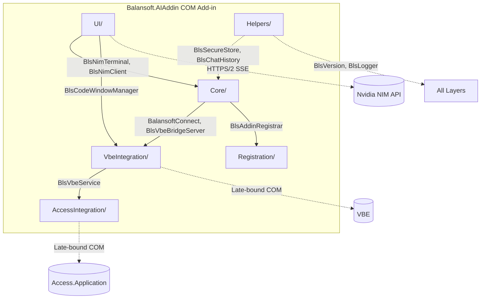
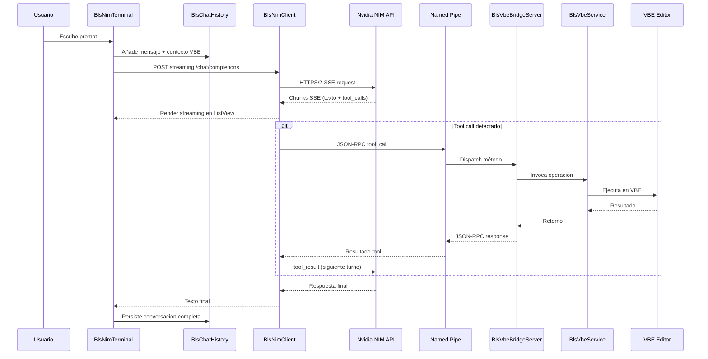

# PRD — Balansoft Access VBA Agent (NIM Direct)

--- 
version: 0.1.0
date: 2025-10-15
status: approved
iso_standard: [29148, 25010, 12207]
aligns_to: [AGENTS.md, ADR-001..012, all skills]
tags: [product, requirements, access-addin, nvidia-nim]
dependencies: []
conflicts_with: []
reviewed_by: [bls-documentador, bls-architect]
--- 

**Producto:** Complemento COM (COM Add-in) para Microsoft Access 2010+ que integra **Nvidia NIM** directamente en el editor de VBA (VBE).
**ProgID:** `Balansoft.AIAddin.Access`
**CLSID:** `{d31bf73e-dbe1-4739-84bc-2c974fcd3171}`
**Estado:** En desarrollo (0.x)
**Versión:** 0.1.0

---

## 1. Propósito

Dar a Access 2010+ (x86 y x64) capacidades de IA **sin dependencias externas** (sin `opencode`, sin CLI, sin MCP). El add-in expone el VBE y el proyecto Access a un modelo NIM vía API streaming, con terminal integrada en el VBE.

## 2. Problema

- El mantenimiento de VBA en Access es costoso y repetitivo.
- La arquitectura anterior dependía de `opencode` (CLI + servidor HTTP + MCP bridge) → complejidad operativa, punto de fallo extra, actualizaciones desacopladas.
- El usuario quiere: **un solo binario**, una sola API key, un modelo fijo (Nemotron 3 Ultra), y que funcione offline salvo la llamada a NIM.

## 3. Solución

Un COM Add-in que:
1. Se registra en HKCU (sin admin) y carga en Access x86.
2. Expone un **bridge JSON-RPC 2.0** sobre Named Pipe (`\\.\pipe\balansoft-opencode`) con 10 operaciones: 7 para módulos VBA y 3 de solo lectura para objetos Access.
3. Incluye **cliente NIM embebido** (`BlsNimClient`): HTTP/2 streaming a `https://integrate.api.nvidia.com/v1/chat/completions` (SSE, tool calls).
4. **Terminal WinForms simple** (`BlsNimTerminal`): TextBox input + ListView conversación, alojada en ventana propiedad del VBE (menú Tools → "NIM Terminal").
5. **API key en DPAPI** (`BlsSecureStore`): cifrado atado a usuario/máquina, sin archivos planos.
6. **Historial persistente** (`BlsChatHistory`): JSON por proyecto Access en `%APPDATA%\Balansoft\AIAddin\history\{projectGuid}.json`.

## 4. Alcance (MVP)

**Incluido:**
- Terminal NIM embebida en ventana propiedad del VBE
- Bridge JSON-RPC con 10 operaciones (7 VBE + 3 Access read-only)
- Cliente NIM streaming (chat/completions, tool calls, abort)
- Registro HKCU vía `regasm /codebase`, scripts `RegisterAddin.ps1` / `UnregisterAddin.ps1`
- Empaquetado distribuible (`Pack.ps1`)
- Logger rotación 7 días, captura global excepciones, versión+commit en log
- API key DPAPI, modelo fijo `nvidia/nemotron-3-ultra-550b-a55b` (configurable vía `NIM_MODEL`)
- Historial por proyecto Access (persistente)
- Textos en español (inglés pendiente)

**Excluido:**
- Selección de modelo/proveedor en UI (modelo fijo en código)
- Panel de configuración (solo API key via DPAPI prompt si falta)
- Autocompletado inline en editor VBE
- Chat multi-sesión concurrente (una terminal a la vez)
- Soporte Access x64, Word, Excel
- Proveedores alternativos (OpenAI, Anthropic, local)

## 5. Objetivos de éxito

| Objetivo                         | Métrica                                                      |
|----------------------------------|--------------------------------------------------------------|
| Velocidad tareas VBA repetitivas | ≥ 30% menos tiempo                                           |
| Adopción interna                 | ≥ 2 proyectos cliente en uso 3 meses                         |
| Fiabilidad                       | 0 fallos de carga en arranque Access                         |
| Seguridad                        | API key solo en DPAPI, nunca en disco plano                  |
| Calidad                          | ≥ 80% respuestas aplicables sin retoques mayores             |
| Simplicidad operativa            | Un solo binario + scripts, sin dependencias runtime externas |

## 6. Historias de usuario (priorizadas)

1. Abrir "NIM Terminal" desde Tools del VBE y pedir "crea módulo Utils con función Suma"
2. Seleccionar código en VBE y que NIM lo vea para refactorizar/explicar
3. Que NIM cree módulos, clases y formularios vía bridge RPC
4. Consultar tablas, consultas, formularios, informes, macros de la BD
5. Recibir errores reales, nunca un "hecho" falso
6. API key guardada una vez (DPAPI), no vuelve a preguntar

## 7. Requisitos funcionales

| ID    | Requisito                                                                                                               | Prioridad |
|-------|-------------------------------------------------------------------------------------------------------------------------|-----------|
| FR-01 | Carga en `OnStartupComplete`, limpieza en `OnDisconnection`/`OnBeginShutdown`, tolerante a `COMException` y `VBE==null` | P0        |
| FR-02 | Terminal WinForms en ventana propiedad del VBE, cliente NIM streaming SSE, tool calls, abort                            | P0        |
| FR-03 | Contexto módulo activo y selección vía `vbe.get_selection()` / `vbe.get_active_module()`                                | P0        |
| FR-04 | Bridge JSON-RPC 2.0 en `\\.\pipe\balansoft-opencode` con 7 métodos VBE + 3 Access                                       | P0        |
| FR-05 | Menú Tools → "NIM Terminal" (español)                                                                                   | P1        |
| FR-06 | Registro solo HKCU, LoadBehavior=3, scripts (des)registro                                                               | P0        |
| FR-07 | Logger diario rotación 7 días, captura global excepciones, versión+commit en primera línea                              | P1        |
| FR-08 | `BlsSecureStore`: DPAPI para API key; prompt si no existe; nunca texto plano                                            | P0        |
| FR-09 | `BlsNimClient`: POST streaming a NIM `/chat/completions`, tool calls (bridge RPC), reconexión, timeout 120s             | P0        |
| FR-10 | `BlsChatHistory`: JSON por proyecto en `%APPDATA%\Balansoft\AIAddin\history\`, carga al abrir terminal                  | P0        |
| FR-11 | 3 operaciones read-only Access: resumen, listado (SQL, #campos), detalle con campos; omite `MSys*`, `~*`                | P0        |
| FR-12 | Errores reales propagados: fallo COM/NIM → error con categoría y mensaje original                                       | P0        |

## 8. No funcionales críticos

- **Compatibilidad:** Access 2010–365, **x86 y x64** (la arquitectura del add-in se pasa con `-p:PlatformTarget` y debe coincidir con la de Access instalada), sin PIAs (enlace tardío `dynamic`)
- **Rendimiento:** UI no bloqueante; NIM en background thread; marshaling a hilo UI antes de tocar VBE
- **Calidad:** C# .NET Framework 4.8, LangVersion 10, `Nullable=annotations`,
  `TreatWarningsAsErrors`, analizadores CA activos vía `.editorconfig`
- **Tests:** Unitarias sin Office (MockVbe, FakeVbeCom, FakeAccessApp); integración manuales con Access real

## 9. Arquitectura

| Capa                         | Responsabilidad                                                                                                                       |
|------------------------------|---------------------------------------------------------------------------------------------------------------------------------------|
| `Core/`                      | Ciclo de vida COM (`BalansoftConnect`), orquestador (`BalansoftAddin`), bridge server (`BlsVbeBridgeServer`), constantes, excepciones |
| `VbeIntegration/`            | `BlsVbeService` (automatización VBE), `BlsCodeWindowManager` (ventana propietaria), `BlsVbeMenuManager` (menú Tools)                  |
| `AccessIntegration/`         | `BlsAccessObjectService` (consulta objetos proyecto, solo lectura)                                                                    |
| `UI/`                        | `BlsNimTerminal` (WinForms: TextBox + ListView), `BlsNimClient` (HTTP/2 streaming NIM)                                                |
| `Registration/`              | `BlsAddinRegistrar`, `BlsRegistryHelper` (HKCU)                                                                                       |
| `Helpers/`                   | `BlsSecureStore` (DPAPI), `BlsChatHistory` (persistencia), `BlsVersion`, `BlsLogger`, `BlsComHelper`, `BlsAssemblyResolver`           |
| `Properties/AssemblyInfo.cs` | Solo `ComVisible`, `Guid`, `InternalsVisibleTo` (versión en `Directory.Build.props`)                                                  |

## 10. Flujo de datos (prompt → respuesta)

## 11. Criterios de aceptación MVP

1. Access (2010/2016/365, x86) carga add-in sin errores
2. Tools → "NIM Terminal" abre terminal WinForms en ventana propiedad del VBE
3. Terminal envía prompt a NIM streaming y renderiza respuesta en vivo
4. NIM puede invocar tool calls → bridge RPC → VBE (crear/leer/escribir/borrar módulos, selección, objetos Access)
5. Historial persiste por proyecto Access y se restaura al reabrir
6. API key se guarda en DPAPI tras primer prompt si no existe
7. Bridge iniciado en `AttachVbe`, detenido en shutdown
8. Logger rota 7 días, captura excepciones, versión+commit en log
9. 79 tests pasan (73 sin Office + 6 de integración NIM)
10. Fallos COM/NIM llegan como error, nunca como éxito