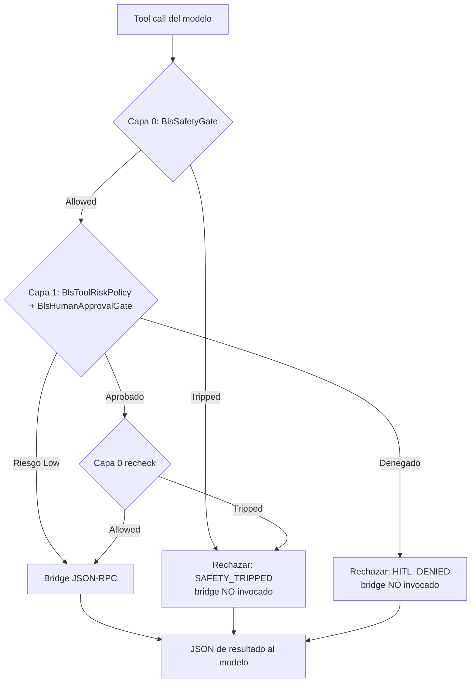

# ADR-015 — Supervisión humana, fail-safe y kill switch

## Contexto

La tool loop del add-in puede emitir tool calls que escriben o destruyen objetos del proyecto
VBE/Access (`write_module`, `delete_module`, `execute_sql`, `migrate_*`). Antes de F2:

- el parámetro `confirm` lo entregaba **el propio modelo** en el JSON de argumentos (R-01);
- `BlsComHelper.DeleteModule` hacía `if (vbe == null || !confirm) return;`, por lo que un
  fallo se reportaba al modelo como éxito (R-02, falso éxito / ASI09);
- "Detener" cancelaba el turno, pero no impedía que el usuario enviara uno nuevo; no existía
  un parada determinista e independiente del razonamiento del modelo (Pilar 3).

El riesgo se considera **Crítico** en `AI-RISK-REGISTER.md` y bloquea el uso en producción.

## Decisión

Se introduce una arquitectura de **tres capas**, ejecutadas en este orden para cada tool call:

### Capa 0 — Kill switch (`BlsSafetyGate`)

- Estado `tripped` con `Trip(reason)`, `Reset()` y `EnsureAllowed()`.
- `EnsureAllowed()` lanza `BlsSafetyTrippedException` **antes** de iniciar un turno y **antes**
  de cada tool call.
- El botón de la terminal activa `Trip`, cancela el `CancellationTokenSource` del turno y
  bloquea el botón "Enviar". Solo una pulsación humana lo reactiva.
- Es independiente del modelo: ningún prompt puede desactivarlo.

### Capa 1 — Política de riesgo y aprobación (`BlsToolRiskPolicy`, `BlsHumanApprovalGate`)

- Clasificación determinista: lectura = `Low`; escritura no destructiva = `Medium`;
  destructiva/migratoria = `High`. **Tool desconocida ⇒ `High`** (fail-safe).
- `Low` no pide aprobación; `Medium` y `High` requieren un `MessageBox` modal con
  `MessageBoxDefaultButton.Button2` ("No" por defecto).
- Ante fallo del diálogo, excepción o cancelación, la decisión es **Denied** (fail-safe).
- `BlsApprovalRequest` incluye `payload_sha256`: se registra el hash, nunca el payload en claro.

### Capa 2 — Bridge

- Solo se invoca si pasaron las capas 0 y 1. Un rechazo devuelve
  `{"error": "...", "code": "HITL_DENIED"|"SAFETY_TRIPPED", "tool": "...", "payload_sha256": "..."}`.
- Nunca se devuelve éxito falso: `BlsComHelper.DeleteModule` lanza
  `BlsPreconditionException` si no hay VBE o si `confirm` es `false` (DbC, ADR-005).

## Alternativas consideradas

| Alternativa                                | Por qué se descartó                                            |
|--------------------------------------------|----------------------------------------------------------------|
| Confiar en `confirm` del modelo            | Es el propio atacante/instrumento quien lo controla (ASI01).   |
| Desactivar todas las tools de escritura    | Inviabiliza el caso de uso principal (edición de VBA).         |
| Un único botón "Detener" reutilizado       | No impide un nuevo turno; no es un estado persistente.         |
| Diálogo de aprobación para TODAS las tools | Fatiga de aprobación: el usuario acaba haciendo clic sin leer. |

## Consecuencias

**Positivas**

- Cierran los riesgos R-01, R-02 y R-12 del registro.
- Cada aprobación/denegación queda registrada con hash del payload y sin PII en claro.
- El rechazo es visible para el modelo como JSON de error, sin abortar el turno.

**Negativas / pendientes**

- El usuario debe confirmar cada escritura; es el coste deliberado del Pilar 4.
- El MessageBox se muestra en el hilo UI mediante `Invoke` síncrono: bloquea el turno hasta
  responder. Es intencionado (HITL), pero requiere que el hilo UI esté respondiendo.
- La política de riesgo usa una tabla de nombres en `Helpers` (Core depende de Helpers, no al
  revés). Debe sincronizarse con `JsonRpcMethods.All`; un test de integración futura debería
  verificar que toda tool de la whitelist aparece clasificada.
- F3 añadirá `correlation_id` y cadena SHA-256 a estos eventos HITL.

## Evidencia

- Tests: `BlsSafetyGateTests` (18), `BlsComHelperSafetyTests` (3),
  `BlsStringsTests.SafetyStrings_PresentInAllLanguages` (1) — 22 nuevos, 188/188 verdes.
- Gate de CI: *Fail-safe y supervision humana (HITL)*.
- Spec: `specs/016-HUMAN-IN-THE-LOOP.md`.

## Fase 1 - Refuerzo en la frontera del pipe (2026-11-22)

La auditoria de gobernanza detecto que el kill switch y la aprobacion humana solo se comprobaban en `BlsNimTerminal`. Como el bridge JSON-RPC expone un named pipe, un proceso local del mismo usuario podia invocar `delete_module` o `execute_sql` directamente contra `JsonRpcDispatcher` sin pasar por la UI.

Decision: mover las tres comprobaciones deterministas a la frontera del pipe, sin sustituir las de la terminal (defensa en profundidad).

- `BlsToolAuthorizationRegistry` emite un token opaco de 128 bits tras la aprobacion UI. Es de un solo uso, caduca a los 60 s y se vincula a `method`, `correlation_id` y `SHA-256(payload)`.
- `JsonRpcDispatcher` comprueba `BlsSafetyGate.EnsureAllowed()` antes de cualquier handler; exige el token para tools `Medium`/`High` y devuelve `HITL_DENIED` (-32005) sin ejecutar; aplica el tope de 32 tool calls por turno con `TOOL_ITERATION_LIMIT` (-32007).
- `BlsVbeBridgeServer.BuildPipeSecurity()` sustituye la ACL por defecto de Windows por una unica regla que concede `FullControl` al SID del usuario actual (ISO 27001 A.8.15 / OWASP ASI03).
- `AddinConnect` crea un unico `BlsSafetyGate` y un unico registro y los comparte entre terminal y bridge.

Criterios de aceptacion nuevos: un frame sin token sobre `delete_module` responde -32005 y no ejecuta; con kill switch disparado responde -32006; el noveno frame de un turno responde -32007. Evidencia: `JsonRpcSafetyTests` (7) y `BlsPipeSecurityTests` (1), gate 8c ampliado.