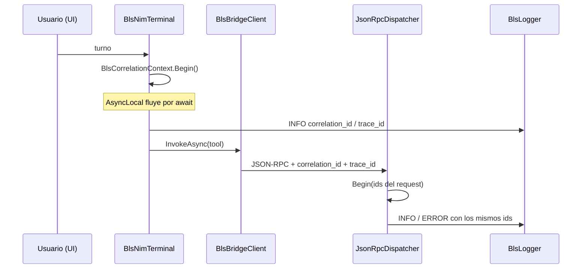

# ADR-016 — Registro de auditoría JSON, hash encadenado y trazabilidad

## Contexto

ADR-011 entregó un logger de texto plano y excluyó explícitamente el logging
estructurado, la firma del log y la auditoría. F2 añadió decisiones HITL y eventos
de kill switch que se registraban con `payload_sha256`, pero seguían siendo
líneas de texto sin encadenar. En consecuencia:

- **R-04**: no había forma de demostrar que una línea del log no se había
  modificado (Pilar 6, IETF AAT / EU AI Act Art. 12).
- **R-05**: no había `correlation_id` ni `trace_id` que vincularan el turno del
  usuario, la tool call, la respuesta del bridge y el error (Pilar 20).
- El logger no redactaba credenciales: la primera barrera era el llamador
  (ADR-011 §11.12), frágil ante un mensaje de excepción inesperado.

## Decisión

`BlsLogger` pasa a ser un **logger de auditoría append-only** que escribe JSON
Lines en `balansoft-yyyyMMdd.log`, conservando la ruta y la rotación diaria de
ADR-011. `IBlsLogger` **no cambia**: los 15 consumidores y `FakeLogger` siguen
compilando sin modificaciones.

### Formato del evento (schema_version = 1)

```json
{"schema_version":1,"ts":"2026-11-19T12:00:00.0000000Z","level":"INFO","component":"BlsNimTerminal","message":"...","correlation_id":"<32 hex>","trace_id":"<32 hex>","exception":{"type":"BlsComException","message":"...","hresult":"80040154"},"prev_hash":"GENESIS","hash":"<64 hex>"}
```

- Un evento por línea, sin BOM, con salto LF y `AutoFlush`.
- Claves en orden fijo para que la canonicalización sea determinista.
- `exception` solo en `Warn`/`Error`:tipo, mensaje saneado y HResult (COM).
  **No se escribe el stack trace**: puede contener rutas de usuario (Pilar 24).
- La cadena se reinicia cada día con `prev_hash = "GENESIS"`, por lo que la
  verificación se hace por fichero. El nombre diario se conserva.

### Cadena SHA-256

```mermaid
flowchart LR
    A[payload_json sin hash] --> C
    P[prev_hash del evento anterior] --> C
    C[SHA256 prev_hash + '|' + payload] --> H["hash (64 hex)"]
    H --> N[Evento siguiente: prev_hash = hash]
    P0[GENESIS] --> P
```

`BlsAuditChain.ComputeHash(prevHash, payloadJson)` calcula el hash.
`BlsAuditChain.Verify(path)` recorre el fichero y comprueba, para cada línea:

1. que `prev_hash` es exactamente el `hash` del evento anterior;
2. que `hash == SHA256(prev_hash + "|" + payload_sin_hash)`.

Cualquier modificación del mensaje o del encadenamiento se detecta en la línea
exacta (`FirstInvalidLine`). Un fichero inexistente o vacío es válido con 0
eventos. Si el último evento está corrupto, el logger **no escribe**: prefiere
perder el evento antes que continuar una cadena falsificada (fail-safe).

### Trazabilidad punta a punta



`BlsCorrelationScope` usa `AsyncLocal<T>` (flujo automático por `await` dentro
del proceso). Como el bridge se ejecuta en otro hilo detrás de una named pipe,
los IDs se envían **explícitamente** en `JsonRpcRequest` (campos opcionales,
compatibles hacia atrás) y el dispatcher los restaura con `Begin(...)`.

### Saneamiento (Pilar 21/24)

`BlsLogSanitizer` es la última barrera antes del disco: redacta `nvapi-*`,
`sk-/pk-/rk-*`, `Bearer ...` y pares `*_API_KEY=`, `password=`, `token=`, etc.,
conservando el nombre de la clave para diagnosticar. Los saltos de línea se
escapan y el mensaje se trunca a 4000 caracteres. **Esta decisión supera
ADR-011 §11.12**: el logger sí sabe qué es una credencial.

### Métricas SLO

`BlsSloMetrics` expone, sin telemetría remota: tasa de éxito de escritura, latencia
p95, tasa de éxito de turnos y rechazos de tools. Objetivos: escritura ≥ 99,9 %,
p95 ≤ 50 ms, turnos ≥ 95 %. Un fallo de escritura no propaga (spec 008 R008),
pero sí decrementa el SLO. La terminal registra el desenlace de cada turno y
cada rechazo HITL/fail-safe.

## Alternativas consideradas

| Alternativa                                 | Por qué se descartó                                                                                 |
|---------------------------------------------|-----------------------------------------------------------------------------------------------------|
| Mantener texto plano y verificar con `grep` | No detecta modificaciones; incumple IETF AAT.                                                       |
| Firmar con clave privada (PKI)              | Requiere gestionar claves en el cliente; el hash encadenado basta para detectar manipulación local. |
| `AsyncLocal` sin propagación por el pipe    | Los logs del dispatcher quedarían sin correlación: roto el R-05.                                    |
| Cambiar la firma de `IBlsLogger`            | 15 consumidores + `FakeLogger` se romperían; incompatible con F2.                                   |
| Redactar solo en el llamador                | Ya falló en F2: excepciones de terceros pueden contener credenciales.                               |

## Consecuencias

**Positivas**

- Cierran R-04 y R-05. Los eventos HITL de F2 incorporan `correlation_id` y
  `payload_sha256`, enlazados al turno completo.
- `BlsAuditChain.Verify` ofrece prueba de integridad ejecutable en CI.
- La API pública de logging no cambia: riesgo de regresión mínimo.

**Negativas / deuda**

- Cada escritura reabre y escanea el fichero para leer el último hash: coste
  O(líneas) por evento. Aceptable por el volumen (cientos de líneas/día); se
  optimizaría con un puntero en memoria si el volumen creciera.
- La cadena es por fichero diario, no global: borrar un día antiguo no rompe
  los demás. La retención de 7 días de ADR-011 sigue **sin implementar** (deuda
  heredada, fuera del alcance de F3).
- Sin `BlsVersion`: la primera línea del día no incluye versión/commit (deuda
  de spec 008 R003).
- El `trace_id` no se envía al proveedor NIM: la correlación es local al add-in.

## Evidencia

- Tests: `BlsAuditLoggerTests` (11), `BlsAuditChainTests` (11),
  `BlsLogSanitizerTests` (10), `BlsCorrelationContextTests` (7),
  `BlsSloMetricsTests` (8), `JsonRpcCorrelationTests` (4) — 51 nuevos,
  **239/239 verdes**.
- Gate de CI: *Auditoría JSON, hash encadenado y correlación (F3)*.
- Spec: `specs/017-AUDIT-LOGGING.md`.

## Fase 2 - Verificacion en ejecucion y cadena entre dias (2026-11-22)

- `BlsAuditChain.VerifyDirectory(logDir)` verifica todos los ficheros `balansoft-yyyyMMdd.log` en orden cronologico. El primer evento de una cadena nueva usa `GenesisHash`; `SeedFor(logDir, date)` toma el ultimo hash del dia anterior como semilla del dia actual. Borrar un dia intermedio rompe la cadena.
- Los logs escritos antes de esta fase empezaban cada dia con `GENESIS`; se reconocen como segmentos legacy y siguen siendo verificables.
- `AddinConnect` llama a `VerifyDirectory(BlsPaths.LogsDir)` al arrancar. Si la cadena es invalida dispara el kill switch: sin trazabilidad fiable no se permite operar (EU AI Act Art. 12 + IEEE 7009).
- `BlsLogger.LastWriteError` expone el ultimo fallo de escritura en lugar de silenciarlo; el evento nunca se falsifica y el error se contabiliza en `BlsSloMetrics`.
- Los `catch { }` de `AddinConnect.RemoveMenu` y `BlsNimClient` (fijacion TLS) ahora registran advertencia.

Evidencia: `BlsAuditChainDirectoryTests` (5) y 327/327 tests verdes; gate 8d con tokens de regresion.