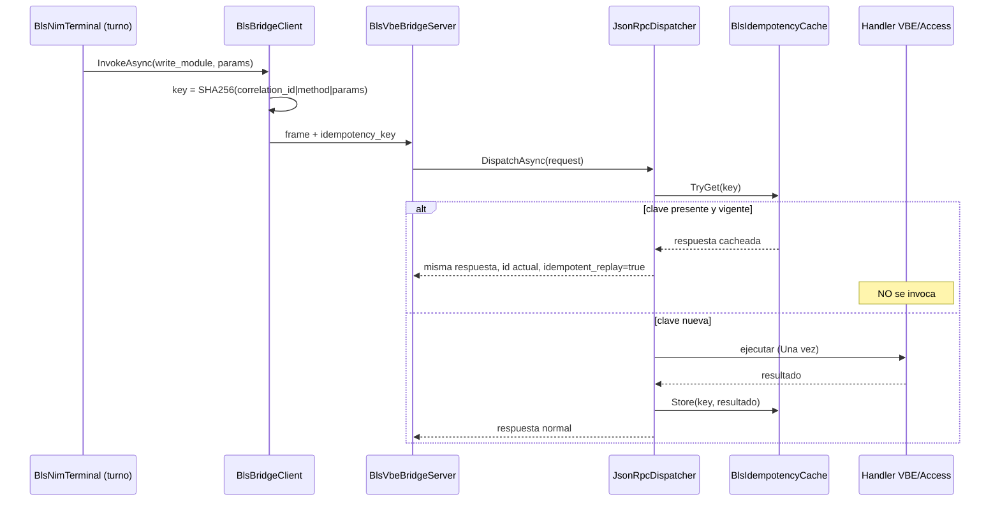
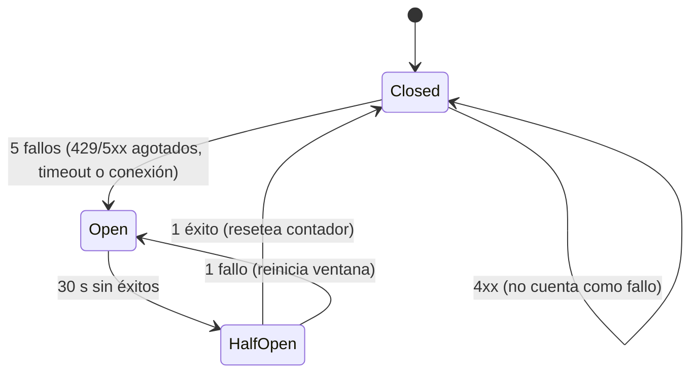

# ADR-017 — Idempotencia del bridge y resiliencia del cliente NIM

> **Norma de referencia:** ISO/IEC/IEEE 42010:2022 (arquitectura),
> ISO/IEC 25010:2023 (fiabilidad) e ISO/IEC 42001:2023 (Pilares 3, 19 y 22).

## Contexto

El bridge JSON-RPC (ADR-002) garantiza entrega de frames y correlación por `id`,
pero **no** garantiza ejecución única. Si un cliente reconecta y reenvía un
frame, o si el modelo emite dos veces la misma tool call, el dispatcher ejecuta
dos veces una operación de escritura. En VBE/Access eso no es benigno: dos
`write_module` pueden dejar el código final distinto del esperado y dos
`execute_sql` pueden duplicar filas. Es el riesgo R-06 (Pilar 19).

El cliente NIM (ADR-007) reintenta 429/5xx con un backoff determinista de
1/2/4 s. Sin jitter, varias instancias que fallen juntas vuelven a coincidir
en la siguiente ventana; sin breaker, un proveedor caído recibe un POST por
cada turno del usuario. Es el riesgo R-09 (Pilar 22).

Cualquier solución debe respetar tres decisiones previas:

1. **ADR-002**: `id` solo correlaciona, no es una clave de idempotencia.
2. **ADR-003**: la cancelación del turno gana sobre reintentos, timeouts y
   esperas; nunca se reporta como error.
3. **ADR-015**: una tool `Medium`/`High` ya pasó por aprobación humana. La
   deduplicación no puede convertir una tool rechazada en ejecutada.

## Decisión

Dos mecanismos independientes, uno por riesgo, ambos inyectables y compatibles
hacia atrás.

### 1. Idempotencia por clave derivada del turno (R-06)

`JsonRpcRequest` incorpora un campo opcional `idempotency_key`. Es un campo
nuevo **al final del record** con `JsonIgnore(WhenWritingNull)`: los frames
antiguos siguen deserializando y el dispatcher los trata como no idempotentes.

`BlsBridgeClient` calcula la clave con:

```
SHA256( correlation_id + "|" + method + "|" + params_json )
```

El `correlation_id` es el de ADR-016, fijo durante el turno. Por tanto:

- reenviar el mismo frame dentro del turno ⇒ misma clave;
- repetir la tool call en otro turno ⇒ clave distinta (operación legítima).

La clave se deriva, no se genera con `Guid.NewGuid()`, porque el cliente no
mantiene estado de reenvío: si un frame se reenvía, debe llegar con la misma
clave sin que el llamador tenga que acordarse de pasarla. Es un SHA-256, así
que los parámetros (que pueden contener código VBA o SQL) no viajan en claro
en el campo.



**Reglas de la caché**

- Solo se cachean respuestas exitosas de tools `Medium`/`High` según
  `BlsToolRiskPolicy` (ADR-015). Lecturas, errores y cancelaciones no se
  cachean: un fallo debe poder reintentarse y una lectura debe ser fresca.
- TTL de 5 minutos, máximo 256 entradas, evicción FIFO. Todo en memoria, por
  proceso, sin persistencia.
- La respuesta cacheada se devuelve con el `id` del request actual y el flag
  `idempotent_replay = true`, para que el cliente y el log distingan un replay
  de una ejecución real.
- El log de acierto incluye solo los 8 primeros caracteres de la clave y el
  `correlation_id` (Pilar 24).
- El constructor público de `JsonRpcDispatcher` mantiene sus 4 argumentos; la
  caché se inyecta por sobrecarga.

### 2. Backoff con jitter y circuit breaker (R-09)

`BlsNimClient` sustituye la tabla fija por una política inyectable
`IBlsNimRetryPolicy`. La implementación de producción es
`BlsExponentialJitterRetryPolicy`:

```
base = 1 s, max = 30 s
delay(attempt) = random(0, min(max, base * 2^attempt))
```

*Full jitter*: el delay se sortea en todo el intervalo, incluido 0. Es lo que
descorrelaciona a varios clientes que fallaron al mismo tiempo. El número de
intentos sigue siendo 3 y el tope 30 s.

`Retry-After` **prevalece** sobre el jitter: si el servidor indica un plazo, se
respeta tal cual con el tope de 30 s. Añadir jitter por encima retrasaría una
respuesta que el proveedor pidió respetar; añadirlo por debajo la incumpliría.



`IBlsCircuitBreaker` expone `State`, `AllowCall()`, `RecordSuccess()` y
`RecordFailure()`. En `Open`, `SendAsync` **no llama a `HttpClient`**: emite
`BlsNimCircuitOpenException` por `OnError`. Es un error tipado con body vacío;
nunca un éxito falso (Pilar 8) ni una cancelación disfrazada (Pilar 3).

En `HalfOpen` solo se autoriza **un** sondeo: `AllowCall()` lo registra y
rechaza cualquier otro concurrente. Si ese sondeo falla (429/5xx agotado,
timeout o conexión) se registra el fallo y el circuito se abre de inmediato,
sin consumir los 3 reintentos. El error propagado es el del proveedor; el
`BlsNimCircuitOpenException` queda reservado para la petición siguiente, que
ya encuentra el circuito abierto.

Lo que cuenta como fallo del breaker: 429/5xx tras agotar los 3 intentos,
`BlsNimTimeoutException` y fallos de conexión. Lo que **no** cuenta: 401/400 y
demás 4xx (son errores del cliente, no indisponibilidad del proveedor) ni la
cancelación del usuario.

### Compatibilidad (Pilar 23)

- El constructor público de `BlsNimClient` (5 argumentos) no cambia y ahora
  usa jitter + breaker reales.
- El constructor `internal` de 7 argumentos con `TimeSpan[]`, usado por los 28
  tests existentes, no cambia: envuelve la tabla en `BlsFixedRetryPolicy` y
  usa `BlsNoOpCircuitBreaker`. Los tests siguen siendo deterministas.
- Se añaden sobrecargas `internal` para inyectar política, breaker y un reloj
  falso (`Func<DateTimeOffset>`), de modo que los tests de transiciones no
  necesiten `Thread.Sleep` (skill 09).

## Alternativas consideradas

| Alternativa                                         | Por qué se descartó                                                                                               |
|-----------------------------------------------------|-------------------------------------------------------------------------------------------------------------------|
| Usar `JsonRpcRequest.Id` como clave de idempotencia | Es secuencial y cambia en cada reenvío; además ADR-002 lo reserva para correlación.                               |
| `Guid.NewGuid()` por invocación en el cliente       | Un reenvío generaría una clave nueva y volvería a ejecutar la escritura.                                          |
| Clave global sin `correlation_id`                   | Dos turnos legítimos con la misma tool call colapsarían en una sola ejecución.                                    |
| Cachear también lecturas y errores                  | Devuelve datos obsoletos de VBE y congela fallos reproducibles; rompe la semántica de reintento.                  |
| Persistir la caché en DPAPI/disco                   | Añade secretos y estado sin beneficio: tras un reinicio no se puede distinguir un reenvío de una tool call nueva. |
| Jitter sobre `Retry-After`                          | Desobedece la instrucción del servidor (tope o delay mínimo).                                                     |
| Breaker global estático                             | Requiere sincronización entre instancias y la terminal solo crea una; complejidad sin beneficio.                  |
| Esperas reales en los tests                         | Prohibido por skill 09; se inyecta un reloj falso.                                                                |

## Consecuencias

**Positivas**

- Cierran R-06 y R-09. Un frame duplicado ya no ejecuta dos veces una
  escritura; un proveedor caído deja de recibir POSTs durante 30 s.
- La cancelación sigue ganando sobre el breaker (ADR-003) y las tools
  `Medium`/`High` siguen exigiendo aprobación (ADR-015).
- Ninguna firma pública existente se rompe; los 28 tests de NIM y los 27 del
  dispatcher siguen compilando sin cambios.

**Negativas / deuda**

- La caché crece hasta 256 entradas y expira por tiempo; una escritura
  reenviada **después** del TTL se ejecuta de nuevo. Es el precio de no
  persistir estado.
- El *full jitter* introduce no determinismo en producción; los tests lo
  controlan inyectando la función de aleatoriedad.
- El breaker es por instancia de `BlsNimClient`.
- No hay métrica SLO específica para reintentos o aperturas de breaker; se
  registra en `IBlsLogger` y se deja su agregación para F5.

## Evidencia

- Tests: `JsonRpcIdempotencyTests` (9) y `BlsNimResilienceTests` (9) — 18
  nuevos, **305/305 verdes** en x86 y x64 tras F5.
- Gate de CI: *Idempotencia y resiliencia (F4)*.
- Spec: `specs/018-IDEMPOTENCY-RESILIENCE.md`.
