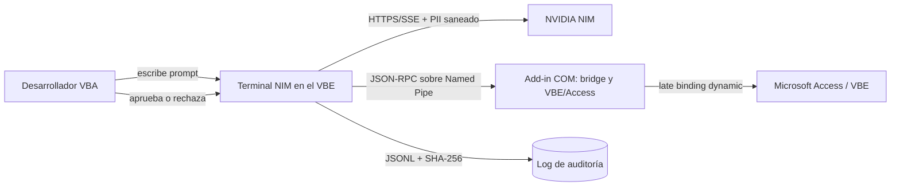
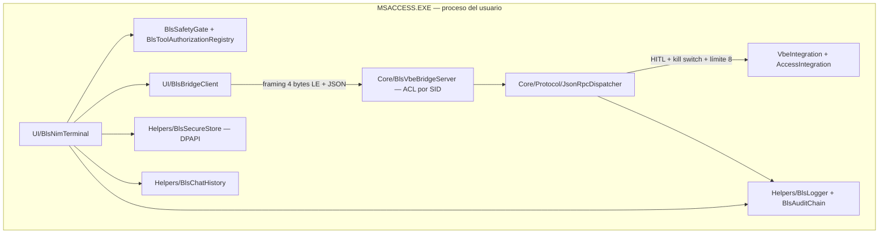
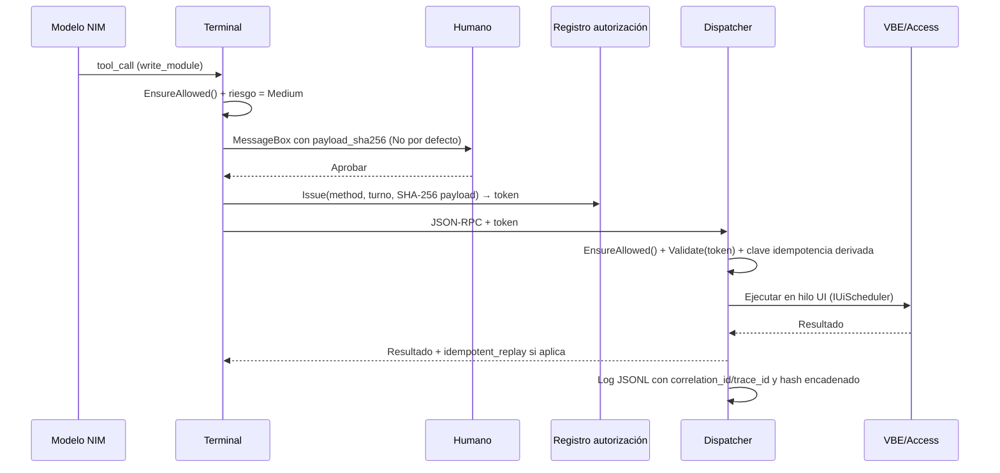

# Arquitectura C4 — Balansoft Access VBA Agent

> Pilar 9 / ISO/IEC/IEEE 42010:2022. Diagramas Mermaid (Pilar 25) donde aportan valor: fronteras de confianza y flujo de una tool call.

## Contexto (C4 Nivel 1)

## Contenedores (C4 Nivel 2)

## Flujo de una tool call de escritura

## Fronteras de confianza

1. **Humano → terminal**: aprobación explícita con "No" por defecto.
2. **Terminal → NIM**: saneamiento PII obligatorio y consentimiento.
3. **Terminal → bridge**: token de un solo uso y pipe restringido al SID del usuario.
4. **Bridge → VBE/Access**: marshaling al hilo UI y DbC en operaciones destructivas.
5. **Cualquier componente → log**: append-only, hash SHA-256 encadenado entre días.
